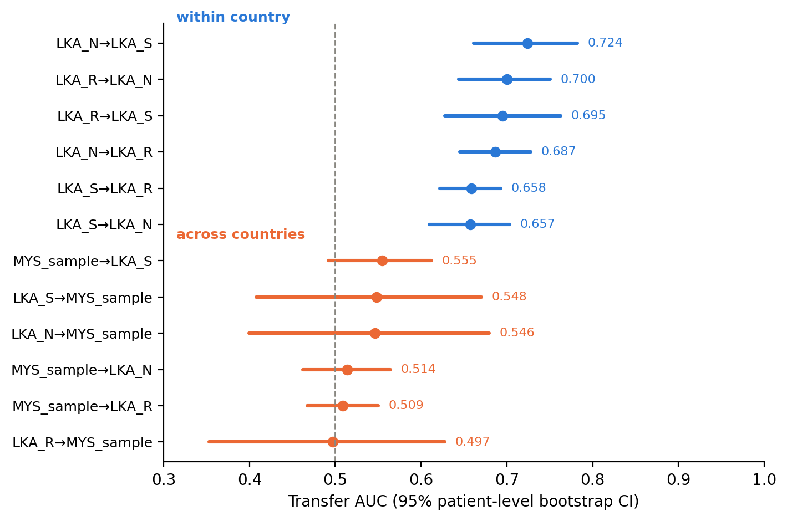

# Cross-Site Generalization of Deep Learning for Oral Lesion Classification

**Does an oral-lesion screening model trained on photos from one clinic still work at a clinic it has never seen?**

DSC 445 group project. We trained a ResNet-18 at each of four clinical sites (three in Sri Lanka, one in Malaysia), then tested it at every other site. That gives 12 train→test directions. Within Sri Lanka the model transferred reasonably well. Across the country border it fell to about chance.

## Main results

| | Within country (6 transfers) | Across countries (6 transfers) |
|---|---|---|
| Mean AUC | **0.687** (range 0.657–0.724) | **0.528** (range 0.497–0.555) |
| Mean high-risk recall | 0.715 | 0.297 |

- All six cross-country 95% CIs include 0.5. The within- and cross-country CIs overlap, so the gap is not reported as statistically significant.
- **Precision/recall (LKA_R → test site):**
  - Within country: 296 of 491 high-risk images caught; recall 0.603 (0.529–0.673), precision 0.734 (0.656–0.813).
  - Across countries: 13 of 39 caught; recall 0.333 (0.175–0.489), precision 0.333 (0.161–0.528).
- **Few-shot adaptation (RQ3):**
  - LKA_S: adding 25 target-site images reached the 90% target (0.656 vs 0.6318). 10 images gave 0.6315, just short.
  - Malaysia: never reached its target (best 0.553 vs 0.558).
- **Selective referral (RQ4):**
  - Within country: referring the least-confident 75% raised accuracy from 0.627 to 0.827 and recall from 0.603 to 0.872.
  - Across countries: recall *fell* (0.333 → 0.273), so model confidence is not a safe guide there.



## Data

The images are **not included** in this repo. The dataset licences don't allow redistribution. To reproduce, get them from the sources:

1. **Sri Lanka:** Piyarathne NS et al. *A comprehensive dataset of annotated oral cavity images for diagnosis of oral cancer and oral potentially malignant disorders.* Oral Oncology 2024;156:106946. Zenodo [doi:10.5281/zenodo.10664056](https://doi.org/10.5281/zenodo.10664056) (CC BY-NC-ND 4.0).
2. **Malaysia (100-image sample):** Chew S et al. *MeMoSA dataset.* Scientific Data 2026;13:923. [doi:10.1038/s41597-026-06998-7](https://doi.org/10.1038/s41597-026-06998-7). Accessed via the MeMoSA Workbench (workbench.memosa.my).

**Sites used:**

| Site | Images | Patients |
|---|---|---|
| LKA_R | 1,445 | 268 |
| LKA_N | 809 | 203 |
| LKA_S | 389 | 170 |
| MYS_sample | 100 | 59 |
| **Total** | **2,743** | **700** |

LKA_C was excluded (253 of 254 images were healthy). LKA_K (103 images) was used only in a 5-site robustness check.

**Labels:** cancer and oral potentially malignant disorders = high-risk; healthy and benign = low-risk.

## Method

- **No patient leakage.** All of a patient's photos stay on the same side of every split (`StratifiedGroupKFold`, enforced with asserts). Confidence intervals come from a patient-level bootstrap (2,000 resamples).
- **Model.** ResNet-18 pretrained on ImageNet (`timm`), with one output logit.
  - Training: AdamW, lr 3e-4, weight decay 1e-4, batch 32, 8 epochs, 224×224 input.
  - Loss: class-weighted BCE.
  - Augmentation: random resized crop, horizontal flip, shift-scale-rotate, colour jitter.
- **Baseline.** Random forest (400 trees) on 118 handcrafted colour/texture features (RGB and HSV histograms, LBP).
- **Fixed training budget.** Each source site is capped at 640 images, so a bigger site can't win just by having more data.

## Repo layout

```
src/
  pipeline.py                  data scoring, CV/LOSO evaluation, RF + ResNet-18 predictors
  finish_project.py            RQ1 / RQ2 reruns with patient-level CIs, permutation test, figures, audit
  finish_rq34.py               RQ3 few-shot adaptation and RQ4 risk–coverage (referral)
  metrics_precision_recall.py  precision / recall / F1 with patient-level bootstrap CIs
notebooks/
  oral_cancer_crosssite.ipynb  full Colab working notebook (outputs cleared)
results/
  tables/                      every results table used in the report (earlier_runs/ = superseded first-pass tables)
  figures/                     transfer, ROC, confusion-matrix and risk–coverage plots
reports/
  Oral_Cancer_Group_Report_Final.pdf
```

## Running it

The code was run in Google Colab with a GPU.

1. Put the data under `oral_cancer_crosssite/data/` in your Google Drive.
2. Set `ROOT` in `src/finish_project.py` to that folder.
3. Run:

```python
import sys; sys.path.insert(0, f"{ROOT}/src")
import finish_project as F
F.step0_load(); F.step2_rerun_rq1(); F.step3_rerun_rq2()
F.step4_permutation(); F.step5_budget_direction_check(); F.step6_figure()
```

Then RQ3/RQ4 via `finish_rq34.py` (see its docstring). The notebook builds the `manifest_all.csv` file the scripts expect.

```bash
pip install -r requirements.txt
```

## Team

DSC 445, DePaul University: **Simran Chauhan** (project lead: data pipeline, experiments, analysis), Manisha Maram, Pujitha Gokamala, Gauthami Sirigudi.
